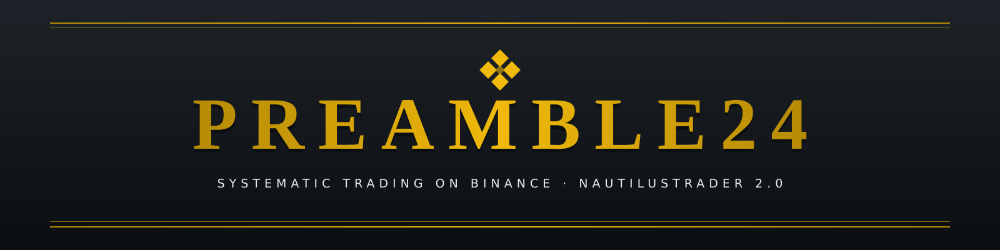
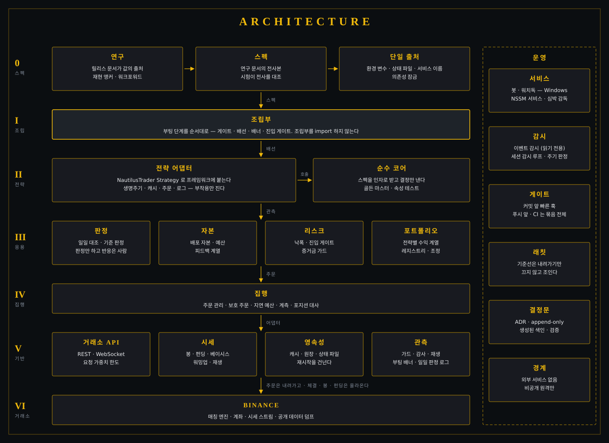
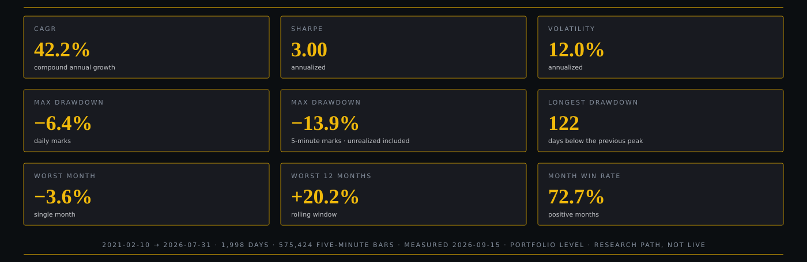

<div align="center">



<a href="https://github.com/Kimseonu0919/preamble24-showcase/actions/workflows/ci.yml"></a>

[한국어](README.md) · **English**

</div>

> [!NOTE]
> This is the **public engineering showcase** of **PREAMBLE24**, a privately operated trading system.
> It contains no production code, strategy parameters or credentials. Architecture, decision records (ADRs)
> and real problem-solving cases are excerpted and rebuilt as standalone, runnable material.

## What it is

PREAMBLE24 runs several strategies (momentum, mean reversion, trend, calendar) together on Binance USDⓈ-M futures.
It is built on [NautilusTrader](https://github.com/nautechsystems/nautilus_trader) 2.0, runs 24/7 as a Windows service (NSSM),
and its code and test suite also run on Linux CI. Research, validation and live operation live under one repository and one set of rules.

## Highlights

- **Determinism and reproducibility** — same input, same position. Hidden nondeterminism (iteration order, arrival order, which thread runs the GC) is pinned down by contract and proven with permutation and randomized differential tests.
- **The venue is the source of truth** — boundaries where the local cache and the exchange disagree (ambiguous cancels, silent user streams, contract settlement) are closed with reconciliation, hold and reduce-only rules.
- **Research ↔ live parity** — the same pure core runs in backtest and live, checked against research artifacts with golden masters and property-based tests.
- **Quality gates with a ratchet** — lint, types, complexity, dead code, layer contracts and coverage run as one gate bundle; baselines only tighten.
- **Decisions are written down** — every design change is an append-only MADR-style ADR (numbered up to 0282).

## Architecture

<div align="center">

</div>

Research documents are the single source of values; the spec is their transcription, and tests compare the two.
One composition root wires the boot sequence. Each strategy splits into a framework-free **pure core** that only decides
and an **adapter** that only performs side effects. Application, execution and foundation layers depend downward only (enforced by Import Linter).

## Case studies

| # | Problem | Decision | Verification |
|---|---|---|---|
| 1 | Under a gross-exposure cap, data arrival order picked the winners | Fix processing order alphabetically — chosen by degrees of freedom, not performance | All 120 permutations give the same entries; the control diverges |
| 2 | Re-sorting every cycle cost 579 ms and delayed other sleeves' timers by 3.2 s | Normalize on insert with an explicit tie rule; never change the answer | 200 randomized arrival orders match the sorted reference exactly |
| 3 | pyo3 `unsendable` objects were freed by the automatic GC on worker threads | Disable auto GC; one owner thread collects periodically and rejects intruders | Finalizers run only on the owner thread under heavy worker allocation |
| 4 | A cancel stuck in `PendingCancel` for 13 minutes after a TLS drop | Ask the venue directly after 180 s; cancel there if still open, with actor approval | 12 tests (4 mutants); resolved within 3–8 minutes ([ADR 0282](docs/adr/0282-stuck-pending-cancel-resolved-at-venue.md)) |
| 5 | Unknown arrival-book cost; settled contracts causing repeated rejects | Persist arrival mid; close settled books; reconcile within a request-weight budget; reduce-only on held symbols | Weight ceiling ≤305 per audit ([ADR 0259](docs/adr/0259-arrival-book-contract-settlement-and-venue-guard-boundaries.md)) |

Cases 1–3 run in [`showcase/determinism/`](showcase/determinism/README.md) (stdlib only, ~0.2 s). Details (Korean): [docs/case-studies](docs/case-studies/README.md).

## Backtest

<div align="center">

</div>

5-minute mark path with unrealized PnL; fees, slippage and funding reconciled against the live fill ledger; 4,000-path Monte Carlo tail risk;
grid → candidates × seeds selection under four risk budgets; window/year/block-bootstrap robustness and Deflated Sharpe Ratio; SHA-256 fingerprinted inputs.

> [!IMPORTANT]
> Portfolio-level research-path backtest, not live performance. The selection window is not out-of-sample; the first out-of-sample period is live. Not investment advice.

## Run

```bash
python showcase/determinism/determinism_showcase.py   # no dependencies
pip install pytest ruff && ruff check . && python -m pytest
```

## Contact

GitHub [@Kimseonu0919](https://github.com/Kimseonu0919) · ksy02k@gmail.com

<sub>Showcase code is MIT-licensed; documents and figures remain the author's.</sub>
