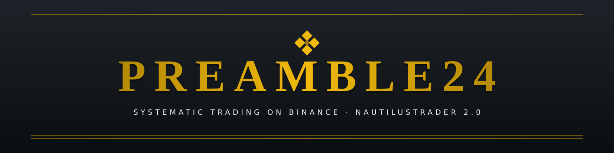
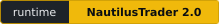
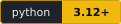
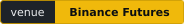
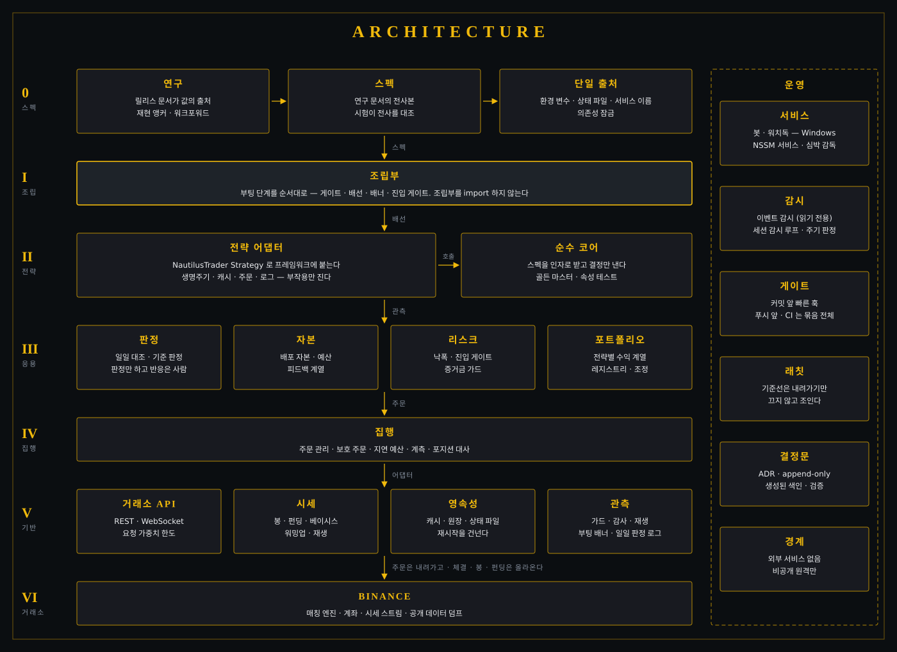
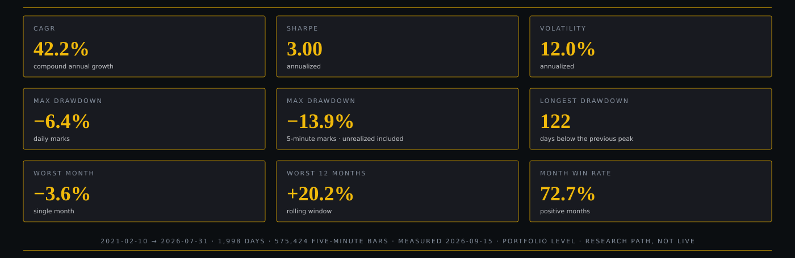
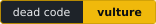
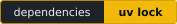
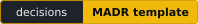

<div align="center">



<p>





</p>

<p>
<a href="https://github.com/Kimseonu0919/preamble24-showcase/actions/workflows/ci.yml"></a>
</p>

**한국어** · [English](README.en.md)

</div>

> [!NOTE]
> 이 저장소는 비공개로 운영 중인 매매 시스템 **PREAMBLE24** 의 **공개 엔지니어링 쇼케이스**입니다.
> 운용 코드 · 전략 파라미터 · 자격 증명은 포함하지 않으며, 설계 · 결정문(ADR) · 문제 해결 사례를
> 단독 실행 가능한 형태로 발췌 · 재구성해 공개합니다.

## 소개

**PREAMBLE24** 는 바이낸스 USDⓈ-M 선물에서 여러 전략을 함께 운용하는 체계적 매매 시스템입니다.
[NautilusTrader](https://github.com/nautechsystems/nautilus_trader) 위에서 Windows 서비스(NSSM)로 상시 가동하며(코드와 테스트 스위트는 Linux CI 에서도 돕니다),
연구 · 검증 · 실운용을 하나의 저장소와 하나의 규약 아래 둡니다.

## 5분 안에 보기

| 보고 싶은 것 | 어디서 |
|---|---|
| 시스템 전체 구조 | [아키텍처](#아키텍처) |
| 라이브에서 실제로 푼 문제와 그 검증 | [엔지니어링 사례](docs/case-studies/README.md) |
| 동작하는 코드 (표준 라이브러리만, 0.2초) | [`showcase/determinism/`](showcase/determinism/README.md) |
| 결정을 남기는 방식 | [결정문(ADR) 발췌](docs/adr/README.md) |
| 백테스트를 믿을 수 있게 만드는 장치 | [백테스트](#백테스트) |

## 핵심 역량

- **결정론과 재현성** — 같은 입력이면 같은 포지션. 처리 순서 · 도착 순서 · GC 스레드처럼 숨은 비결정성을 계약으로 고정하고 순열 · 무작위 대조 시험으로 증명합니다.
- **거래소를 정본으로 두는 운영** — 로컬 캐시와 거래소 상태가 갈리는 경계(모호한 취소, 침묵한 사용자 스트림, 계약 정산)를 찾아 대사 · 보류 · 감축 규칙으로 닫습니다.
- **연구와 실운용의 정합성** — 같은 순수 코어가 백테스트와 라이브에서 돌고, 골든 마스터와 속성 테스트(Property-based testing)로 연구 산출물과 대조합니다.
- **품질 게이트와 래칫** — 린트 · 타입 · 복잡도 · 죽은 코드 · 층 계약 · 커버리지를 하나의 게이트 묶음으로 돌리고, 기준선은 조이기만 합니다.
- **결정의 기록** — 모든 설계 변경은 MADR 템플릿의 append-only ADR 로 남깁니다(번호 0282 까지 누적).

## 아키텍처

<div align="center">

</div>

- **연구 → 스펙 → 실행.** 연구 문서가 값의 유일한 출처이고 스펙은 그 전사본입니다. 봇은 부팅 때 스펙이 가리키는 현행 판 연구 문서가 실재하는지 확인하고(없으면 기동하지 않습니다), 값의 전사는 테스트가 연구 문서와 대조합니다.
- **조립부(Composition Root) 하나**가 부팅을 순서대로 조립합니다. 객체 생성과 배선은 그 안에만 있습니다.
- **전략**은 결정만 내는 순수 코어와 부작용만 지는 어댑터로 나뉩니다. 프레임워크를 모르는 코어는 결정론적이고 시험할 수 있습니다.
- **응용 · 집행 · 기반**은 아래로만 의존합니다. 층 방향은 Import Linter 계약이 지킵니다.
- **이름과 값의 출처**는 한 곳씩입니다. 다른 자리의 리터럴은 검사가 잡습니다.
- **같은 코어가 백테스트와 라이브에서** 돕니다. 라이브에서만 생기는 차이(거래소 · 전송 · 시간차 · 영속성 · 정산 대사)는 매일의 판정과 계측으로 관측합니다.

## 엔지니어링 사례

라이브 봇에서 실제로 마주친 문제와, 그것을 어떻게 결정하고 검증했는지입니다. 자세한 내용은 [사례 모음](docs/case-studies/README.md)에 있습니다.

| # | 문제 | 결정 | 검증 |
|---|---|---|---|
| 1 | 총액 상한 경합에서 데이터 도착 순서가 승자를 정함 | 처리 순서를 성과가 아닌 *자유도* 기준으로 알파벳순 고정 | 5! = 120 순열 전부 동일 결과 · 대조군은 갈림 |
| 2 | 주기마다 재정렬로 579 ms 소모, 다른 슬리브 타이머 3.2 s 지연 | 삽입 시점 정규화 + 동률 규칙 명시, 답은 바꾸지 않음 | 200회 무작위 도착 순서가 정렬 기준 구현과 정확히 동일 |
| 3 | pyo3 unsendable 객체가 워커 스레드의 자동 GC 에서 해제되어 사고 | 자동 GC 를 끄고 소유 스레드 하나가 주기 회수, 침입자 거부 | 워커 대량 할당에도 종료자는 소유 스레드에서만 |
| 4 | TLS 끊김으로 취소가 `PendingCancel` 에 13분 갇힘 | 180 s 넘게 갇힌 주문을 거래소에 직접 묻고, 열려 있으면 승인 후 취소 | 시험 12건(변이 넷) · 갇힘 3~8분 내 해소 ([ADR 0282](docs/adr/0282-stuck-pending-cancel-resolved-at-venue.md)) |
| 5 | 결정 가격만으론 실제 도착 호가 비용 불명, 정산 계약 장부가 반복 거부 유발 | 도착 호가 별도 보존 · 정산 후 장부 종료 · 요청 가중치 예산 안의 독립 대사 · 보류 종목은 reduce-only | 가중치 상한(감사당 ≤305) 산정 · 항목별 증거 ([ADR 0259](docs/adr/0259-arrival-book-contract-settlement-and-venue-guard-boundaries.md)) |

## 백테스트

<div align="center">

</div>

| 항목 | 방법 |
|---|---|
| 가격 경로 | 5분 마크 경로 · 미실현 손익과 시작 자기자본 포함 · 정산 가격 셋(마크 · 불리 · 유리) |
| 비용 | 수수료 · 슬리피지 · 펀딩 모형 · 라이브 체결 원장과 대조 |
| 꼬리 위험 | 몬테카를로 4,000 경로 · 최대 낙폭 p99 −12.7% · 전략 쌍 동시 낙폭 p95 −15.0% |
| 선택 | 격자 2,226점 → 후보 70 × 시드 10 → 실제 명목 금액 127점 · 위험 예산 넷(각 15%)을 모든 시드가 통과하는 점만 |
| 강건성 | 창별 · 연도별 · 블록 부트스트랩 · DSR(Deflated Sharpe Ratio) · 명목 금액 민감도 |
| 표본 외 | 선택 창은 표본 외(out-of-sample)가 아님 · 첫 표본 외는 라이브 |
| 재현 | 입력 · 스크립트 SHA-256 지문 · 불변 앵커 |

> [!IMPORTANT]
> 위 수치는 연구 경로(research path)의 포트폴리오 수준 백테스트이며 라이브 성과가 아닙니다.
> 선택에 쓰인 창은 표본 외가 아니므로 기대 성과로 읽으면 안 됩니다. 투자 권유가 아닙니다.

## 규약

원 저장소에서 운용하는 품질 규약입니다. 이 쇼케이스 저장소에는 그중 ruff · pytest · GitHub Actions 만 축소 적용했습니다.

### 코드

<p>







</p>

모든 검사는 하나의 게이트 묶음으로 돕니다. 커밋 앞에는 빠른 훅이, 푸시 앞에는 게이트 묶음이, CI 에는 묶음과 테스트 스위트가 돕니다.
검사마다 기준선이 있고 기준선은 내려가기만 합니다.

### 문서

<p>



</p>

결정문은 템플릿 하나에서 만들고 한번 쓴 본문은 고치지 않습니다. 색인은 생성물이며 검증됩니다.
문서의 구조와 링크는 검사가 지키고, 문서 사이트는 로컬에서만 빌드합니다.

## 저장소 지도

```text
.
├── showcase/determinism/   결정론 사례 3선 — 표준 라이브러리만, 단독 실행·자기검증
├── tests/                  쇼케이스 불변식 시험 (pytest)
├── docs/
│   ├── case-studies/       문제 → 결정 → 검증 → 결과
│   └── adr/                결정문 발췌 (원문 그대로, append-only)
├── assets/readme/          배너 · 아키텍처 · 백테스트 · 배지 SVG
├── scripts/gen_badges.py   배지 생성기 (외부 배지 서비스 없음)
└── .github/workflows/      CI — Windows · Linux × Python 3.12 · 3.13
```

원 저장소의 구성은 `governance/`(규약 · 계약 · 결정문 · 검사기) · `ops/`(서비스 · 감시 · 인계) · `research/`(릴리스 문서 · 재현 앵커) · `src/`(실운용 코드) 입니다.

## 실행하기

```bash
# 쇼케이스 자기검증 — 의존성 없음
python showcase/determinism/determinism_showcase.py

# 시험과 린트
pip install pytest ruff
ruff check .
python -m pytest
```

```text
1절 OK  — 120개 입력 순열이 모두 같은 진입 목록(상한 경합에서도 결정적)
2절 OK  — 200회 무작위 도착 순서가 정렬 기준 구현과 정확히 동일
3절 OK  — 워커가 아무리 할당해도 정리는 소유 스레드에서만, 침입자는 거부
```

## 공개 범위

| 공개 | 비공개 |
|---|---|
| 아키텍처 · 규약 · 결정문 발췌 · 재구성한 사례 코드 · 백테스트 요약 | 운용 코드 · 전략 로직과 파라미터 · 연구 원자료 · 계정 · 자격 증명 · 운영 로그 |

## 연락처

- GitHub: [@Kimseonu0919](https://github.com/Kimseonu0919)
- Email: ksy02k@gmail.com

<div align="center">

---

<sub>PREAMBLE24 · public showcase · 쇼케이스 코드는 MIT, 문서와 도판은 저작자에게 권리가 있습니다</sub>

</div>
